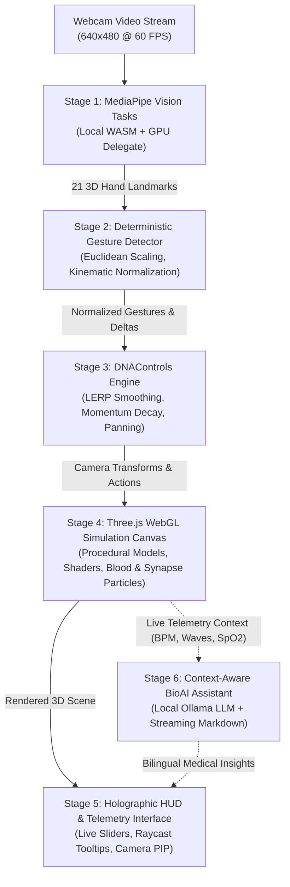
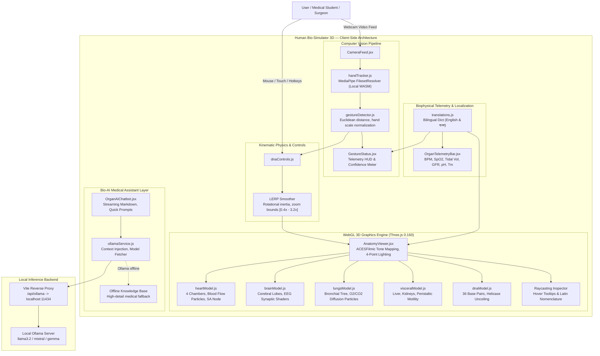

# 🧬 Human Bio-Simulator 3D — Real-Time Anatomy & Genomic Computer Vision Platform

[](https://react.dev/)
[](https://threejs.org/)
[](https://developers.google.com/mediapipe)
[](https://vitejs.dev/)
[](https://tailwindcss.com/)
[](https://ollama.ai/)
[](https://webassembly.org/)
[](https://www.khronos.org/webgl/)
[](src/i18n/translations.js)
[](LICENSE)

Human Bio-Simulator 3D is a browser-native biomedical simulation and visual computing platform that integrates **on-device computer vision hand gesture tracking**, **high-performance WebGL 3D volumetric anatomical rendering**, **real-time biophysical telemetry**, **native bilingual localization (English & বাংলা)**, and a **local context-aware Ollama AI Medical Assistant**.

By combining client-side WebAssembly machine learning with physics-driven shader pipelines, Human Bio-Simulator 3D enables touchless, sterile, and interactive manipulation of human organs and genomic structures directly through standard consumer webcams—with **zero cloud dependencies** and **100% on-device privacy**.

- **Repository**: [https://github.com/Turjo101365/DNA](https://github.com/Turjo101365/DNA)
- **Primary Branch**: `main`
- **Latest Release**: Vision v3.0

---

## Why Human Bio-Simulator 3D?

Understanding human biological systems requires spatial comprehension that traditional 2D textbooks, anatomical atlases, and passive plastic mannequins cannot provide. In clinical education, surgical planning, and sterile operating theatre environments, physical touch interfaces (mice, keyboards, touchscreens) pose cross-contamination risks or break procedural immersion.

Existing 3D medical viewers suffer from key limitations:
- **Cumbersome Input Modalities**: Trapped behind rigid mouse drag/wheel interactions that feel unnatural for volumetric biological inspection.
- **Surface-Level Modeling**: Static meshes without physiological dynamics (blood flow velocity, cardiac conduction, alveolar gas exchange, EEG wave states).
- **Cloud Latency & Privacy Risks**: Video streams sent to third-party APIs for vision tracking violate patient and user privacy.
- **Language & Cultural Barriers**: Complex medical terminology is rarely available in localized regional languages such as Bengali (বাংলা).

**Human Bio-Simulator 3D solves this through strict separation of concerns**:
1. **On-Device Vision Pipeline**: Google MediaPipe Vision running on compiled WebAssembly (WASM) extracts 21 spatial hand landmarks per frame with sub-millimeter precision directly on the client's GPU.
2. **Deterministic Gesture Engine**: Normalizes coordinate spaces against anatomical hand dimensions, filters micro-tremors, and derives 3D orbital rotations, optical zooms, and spatial pinning.
3. **Physiological Shader Engine**: Three.js renders dynamic bio-simulations—pulsating 4-chamber cardiac cycles, synaptic EEG discharge particle fields, alveolar breathing mechanics, and DNA helicase unwinding.
4. **Biophysical Telemetry & Raycast Inspector**: Real-time HUD displays vital telemetry (BPM, SpO₂, tidal volume, renal GFR, base pair Tm stability) with interactive raycasting for anatomical taxonomy.
5. **Context-Aware Medical Intelligence**: A local Ollama LLM assistant ingests live simulator telemetry into its system prompt to answer complex anatomical, pathological, and clinical questions in English, Bengali, or Banglish with zero cloud latency.

---

## Key Capabilities

- **🧬 3D DNA Double Helix & Genomic Unwinding**: Procedural and GLTF-based 36 base-pair macromolecular double helix displaying Watson-Crick hydrogen bonding (A-T, G-C). Dynamically uncoils into an unzipped flat ladder via gesture or telemetry control.
- **🫀 5 Interactive Vital Anatomical Systems**:
  - **Cardiovascular Heart**: 4 chambers, 4 valves, myogenic SA/AV node conduction, ventricular blood flow particle velocity, and tachycardia surge mode.
  - **Neural Brain**: Cerebral cortex (Frontal, Parietal, Temporal, Occipital lobes), Cerebellum, Brainstem, EEG rhythms (Delta, Theta, Alpha, Beta, Gamma), and synaptic discharge particle shaders.
  - **Respiratory Lungs**: Trachea, 23-generation bronchial arborization tree, alveolar capillary beds, diaphragmatic breathing mechanics, and $O_2 / CO_2$ gas exchange particle animation.
  - **Visceral Organs**: Multi-organ digestive and renal simulation: Liver (hepatic bile & metabolism), Gallbladder, Stomach (gastric acid pH 1.5–2.0), Duodenum/Intestines peristalsis, and Kidneys (nephron filtration GFR ~125 mL/min).
  - **Skeletal & Raycast Layer**: Interactive raycaster mapping Latin taxonomy, physiological pressures, volumetric capacities, and clinical pearls on hover.
- **🖐️ Zero-Cloud On-Device Gesture Control**:
  - Open Palm / Pointing: 3D orbital rotation and smooth camera translation.
  - Single-Hand Pinch & Two-Hand Spread: Continuous optical zoom and deep-tissue inspection.
  - Closed Fist: Spatial lock / freeze orientation.
  - Peace Sign (✌️): Triggers organ signature reactions (tachycardia burst, EEG cycle, deep lung inspiration, DNA uncoil).
  - Thumbs Up: Recalibrates and centers 3D camera orientation.
- **🌐 Full Bilingual Localization (English & বাংলা)**: Complete dictionary covering medical terminology, anatomical taxonomy, telemetry units, HUD controls, and AI prompts in both English and Bengali.
- **🌓 Dual Sci-Fi Glassmorphic & Clinical Theming**: Deep space biotech glassmorphic dark theme (`#070b14`) with glowing neon overlays alongside a high-contrast clinical light mode. Preferences persist in `localStorage`.
- **🤖 Local Ollama AI Medical Assistant**: Slide-out medical intelligence assistant powered by local Ollama models (`llama3.2`, `mistral`, `gemma`). Ingests live simulator telemetry into system prompts with streaming Markdown formatting and comprehensive offline knowledge fallback.
- **🔒 100% Offline-Capable & Privacy Preserving**: MediaPipe WASM binaries and machine learning models are bundled locally in `/public`, ensuring complete functionality without internet access.

---

## How It Works



---

## System Architecture



The system is organized into five decoupled, testable layers:

### 1. Presentation & Holographic HUD Layer (`src/App.jsx`, `src/components/`)
Built on **React 18** and **Tailwind CSS 4**. Manages layout states, live framerate tracking, dual-theme switching (`dark` glassmorphic / `light` clinical), language toggles, floating PIP camera overlay, and keyboard shortcuts (`1-5`, `Space`, `R`, `E`, `C`).

### 2. Computer Vision & Kinematic Pipeline (`src/handTracking/`)
Operates `@mediapipe/tasks-vision` via WebAssembly with GPU acceleration. Extracts 21 3D Cartesian coordinates per hand. Eliminates camera mirror confusion by inverting coordinate horizontal axes and dynamically calculates hand scale references.

### 3. WebGL 3D Simulation Engine (`src/models3d/`, `src/controls/`)
Powered by **Three.js (r160)**. Uses an ACESFilmic tone-mapped scene illuminated by a 4-point dynamic lighting rig (Cyan key light, Magenta rim light, Emerald fill light, Ambient base). Incorporates custom procedural geometry, floating ambient bio-particles, and organ-specific particle dynamics.

### 4. Biophysical Telemetry & Raycast Inspector (`src/components/OrganTelemetryBar.jsx`)
Exposes biophysical parameters via interactive controls and calculates real-time hydrodynamic blood pressures, cerebral wave frequencies, alveolar tidal volumes, and renal filtration metrics. Raycasts interactive meshes to display Latin terminology and clinical pearls.

### 5. Local Context-Aware AI Medical Assistant (`src/services/ollamaService.js`, `src/components/OrganAIChatbot.jsx`)
Integrates local LLMs via Ollama. Telemetry values (e.g., current heart BPM, respiration rate, brain wave state) are dynamically interpolated into system prompts. Responses stream in real-time through the Web Streams API with full Markdown parsing. If Ollama is offline, a built-in bilingual medical knowledge base delivers immediate, comprehensive fallback answers.

---

## Hand Gesture Kinematics & Mathematics

```
Webcam Frame (t)
      │
      ▼
MediaPipe HandLandmarker (21 3D Points: P_0 ... P_20)
      │
      ▼
Normalized Hand Scale Reference:
S_hand = || P_9 - P_0 ||_2  (Wrist to Middle MCP Distance)
      │
      ▼
Normalized Pinch Metric:
D_pinch = || P_4 - P_8 ||_2 / S_hand
If D_pinch < 0.28 ──► PINCH GESTURE (Zoom In/Out)
      │
      ▼
Finger Extension Geometry:
d(P_tip, P_wrist) > 1.15 * d(P_pip, P_wrist)  AND
d(P_tip, P_wrist) > 1.30 * d(P_mcp, P_wrist)
      │
      ▼
Spatial Transformation Engine (dnaControls.js):
targetRotation.y += -Δx_palm * sensitivity
targetRotation.x +=  Δy_palm * sensitivity
rotation += (targetRotation - rotation) * α_lerp
```

### Mathematical Formulations

1. **Hand Scale Normalization**:
   To ensure gesture recognition remains invariant to the user's distance from the camera:
   $$S_{\text{hand}} = \|\mathbf{p}_9 - \mathbf{p}_0\|_2 = \sqrt{(x_9 - x_0)^2 + (y_9 - y_0)^2 + (z_9 - z_0)^2}$$

2. **Normalized Pinch Metric**:
   $$\delta_{\text{pinch}} = \frac{\|\mathbf{p}_4 - \mathbf{p}_8\|_2}{S_{\text{hand}}} \quad \text{where } \delta_{\text{pinch}} < 0.28 \implies \text{Active Pinch}$$

3. **Two-Hand Euclidean Spread & Zoom**:
   $$D_{\text{two\_hand}} = \|\mathbf{C}_{\text{palm}, 1} - \mathbf{C}_{\text{palm}, 2}\|_2$$
   $$S_{t} = \text{clamp}\Big(S_{t-1} + (D_{\text{two\_hand}, t} - D_{\text{two\_hand}, t-1}) \cdot 2.0, \quad S_{\min}, \; S_{\max}\Big)$$

4. **Rotational Inertia & LERP Smoothing**:
   $$\boldsymbol{\theta}_t = \boldsymbol{\theta}_{t-1} + (\boldsymbol{\theta}^* - \boldsymbol{\theta}_{t-1}) \cdot \alpha_{\text{lerp}} \quad (\alpha_{\text{lerp}} = 0.12)$$
   $$\mathbf{v}_t = \mathbf{v}_{t-1} \cdot \gamma_{\text{decay}} \quad (\gamma_{\text{decay}} = 0.92)$$

### Gesture Matrix Cheatsheet

| Gesture | MediaPipe Landmark Condition | Mathematical Threshold | 3D Simulation Action | Organ Signature Reaction |
|:---|:---|:---|:---|:---|
| **`OPEN_PALM`** | $\ge 3$ extended fingers ($\mathbf{p}_8, \mathbf{p}_{12}, \mathbf{p}_{16}, \mathbf{p}_{20}$) | $d(\text{tip}, \text{wrist}) > 1.15 \cdot d(\text{pip}, \text{wrist})$ | Continuous 3D orbital rotation & panning | Smooth orbital exploration |
| **`PINCH`** | Thumb tip ($\mathbf{p}_4$) to Index tip ($\mathbf{p}_8$) proximity | $\|\mathbf{p}_4 - \mathbf{p}_8\|_2 / S_{\text{hand}} < 0.28$ | Optical zoom in / zoom out | Deep microvascular / tissue zoom |
| **`TWO_HAND_ZOOM`**| Both hands detected simultaneously | $D = \|\mathbf{C}_{\text{palm}, 1} - \mathbf{C}_{\text{palm}, 2}\|_2$ | Dual-hand coordinate scaling & stretch | Macroscopic organ scaling |
| **`FIST`** | All fingers curled + thumb retracted | $\sum \mathbb{I}(\text{extended}) = 0 \land \neg \text{thumb}$ | Spatial freeze / lock orientation | Locks model in current orientation |
| **`POINT`** | Index finger ($\mathbf{p}_8$) extended; others curled | $\mathbb{I}_8 = 1 \land \sum_{i \in \{12,16,20\}} \mathbb{I}_i = 0$ | Precision raycast alignment | Highlights anatomical structures |
| **`PEACE` (✌️)** | Index ($\mathbf{p}_8$) & Middle ($\mathbf{p}_{12}$) extended | $\mathbb{I}_8 = 1 \land \mathbb{I}_{12} = 1 \land \mathbb{I}_{16,20} = 0$ | Signature organ reaction trigger | Heart: Tachycardia surge<br/>Brain: Cycle EEG wave<br/>Lungs: Deep inspiration<br/>DNA: Uncoil flat ladder |
| **`THUMBS_UP`** | Thumb pointing upward, all other fingers curled | $y_4 < y_3 \land y_4 < y_0 - 0.1 \land \sum \mathbb{I} = 0$ | Camera recalibration & reset | Re-centers camera to origin |

---

## Anatomical Systems & Simulation Specifications

| Organ System | Key Anatomical Components | Primary Physiological Dynamics | Telemetry Parameters | Signature Action (✌️) |
|:---|:---|:---|:---|:---|
| **🫀 Cardiovascular Heart** | Left/Right Ventricles, Left/Right Atria, Aorta, Vena Cava, Pulmonary Trunk, Tricuspid & Mitral Valves | Myogenic SA/AV node conduction, ventricular systole/diastole, ventricular blood flow particle velocity ($1.2 \times \text{BPM}$) | 40–160 BPM, Systolic/Diastolic blood pressure ($120/80\text{ mmHg}$), Cardiac output ($5.0\text{ L/min}$) | Tachycardia surge burst ($128\text{ BPM}$) |
| **🧠 Neural Brain** | Cerebral Cortex (Frontal, Parietal, Temporal, Occipital lobes), Cerebellum, Brainstem | Multi-channel neural oscillations, synaptic discharge emitter with 250 dynamic firing particles | EEG Rhythm (Delta $0.5\text{--}4\text{ Hz}$, Theta $4\text{--}8\text{ Hz}$, Alpha $8\text{--}12\text{ Hz}$, Beta $13\text{--}30\text{ Hz}$, Gamma $>30\text{ Hz}$), $\approx 86\text{ Billion Neurons}$ | Cycles EEG wave mode |
| **🫁 Respiratory Lungs** | Trachea, 23-generation Bronchial Tree, Left/Right Pulmonary Lobes, Alveoli Clusters, Diaphragm | Diaphragmatic excursion, rhythmic tidal volume expansion, $O_2$ (cyan) and $CO_2$ (magenta) gas exchange particle flow | 8–35 Breaths/min, $\text{SpO}_2$ saturation ($98\%$), Resting tidal volume ($500\text{ mL}$), Alveolar surface area ($70\text{--}100\text{ m}^2$) | Deep inspiratory tidal expansion |
| **🫄 Visceral Organs** | Liver (Hepatic Lobes), Gallbladder, Stomach, Duodenum & Intestines, Bilateral Kidneys & Adrenals | Hepatic glycogen metabolism & bile flow, gastric acid breakdown, nephron blood filtration | Renal GFR ($120\text{--}125\text{ mL/min}$), Gastric pH ($1.5\text{--}2.0$), Hepatic blood flow ($1.4\text{ L/min}$), Nephron count ($2.4\text{ Million}$) | Triggers gastric peristalsis |
| **🧬 DNA Double Helix** | 36 Nucleotide Base Pairs, Phosphodiester Backbone, Purines (A, G), Pyrimidines (T, C) | Watson-Crick hydrogen bonding (A=T 2 bonds, G≡C 3 bonds), Helicase uncoiling into a flat ladder | 36 Base Pairs, Helix pitch ($3.4\text{ nm/turn}$), Thermodynamic stability $T_m$ ($82.5^\circ\text{C}$), Unwind Factor $[0.0, 1.0]$ | Uncoils double helix into flat ladder |

---

## Local AI Medical Assistant (Ollama)

The platform embeds a dedicated medical intelligence assistant powered by local Ollama language models.

```
Active 3D Scene (Heart @ 128 BPM, Tachycardia Surge)
                      │
                      ▼
Context Builder (src/services/ollamaService.js):
"You are BioAI, an elite Medical & Anatomical Specialist.
 CURRENT SIMULATOR CONTEXT:
 - Active Organ: Heart (Cardiovascular System) / হৃৎপিণ্ড
 - Live Telemetry: Heart Rate is currently simulated at 128 BPM."
                      │
                      ▼
Vite Reverse Proxy (/api/ollama/api/chat)
                      │
                      ▼
Local Ollama Service (http://127.0.0.1:11434)
Models: llama3.2:3b, llama3, mistral, gemma
                      │
                      ▼
Web Streams API Token Decoding (TextDecoder + JSON stream)
                      │
                      ▼
Real-Time Markdown Rendering in OrganAIChatbot.jsx
```

### Context Injection & Bilingual Intelligence
- **Dynamic Context Injection**: The active organ, anatomical sub-structures, and live telemetry values (such as heart rate BPM, brain wave frequency, or respiratory rate) are automatically injected into the model's system prompt.
- **Language Detection & Adaptation**: Automatically answers in comprehensive Bengali (বাংলা) with standard Latin medical terminology in brackets when queried in Bengali or Banglish, and in structured scientific prose when queried in English.
- **Built-in Offline Knowledge Base**: If Ollama is not running, the assistant automatically switches to a comprehensive built-in medical encyclopedia covering gross anatomy, electrophysiology, and clinical pathologies in both languages.

---

## Project Structure

```
DNA/
├── public/                         # Static assets & offline binaries
│   ├── models/
│   │   ├── hand_landmarker.task    # Bundled MediaPipe Vision 3D task model
│   │   └── dna.glb                 # 3D GLTF biological macromolecule model
│   └── wasm/                       # Bundled offline WebAssembly vision binaries
│       ├── vision_wasm_internal.wasm
│       ├── vision_wasm_internal.js
│       ├── vision_wasm_nosimd_internal.wasm
│       └── vision_wasm_nosimd_internal.js
├── src/
│   ├── components/                 # React UI & holographic HUD components
│   │   ├── AnatomyViewer.jsx       # Three.js WebGL canvas, lighting & raycaster
│   │   ├── CameraFeed.jsx          # PIP webcam monitor & landmark canvas overlay
│   │   ├── GestureStatus.jsx       # Gesture confidence HUD & cheatsheet modal
│   │   ├── MarkdownView.jsx        # Markdown renderer for AI chat stream
│   │   ├── OrganAIChatbot.jsx      # Slide-out Ollama AI assistant drawer
│   │   └── OrganTelemetryBar.jsx   # Live biophysical sliders & vitals HUD
│   ├── controls/
│   │   └── dnaControls.js          # Kinematic gesture processing, LERP & inertia
│   ├── handTracking/
│   │   ├── gestureDetector.js      # Landmark classification, distances & angles
│   │   └── handTracker.js          # MediaPipe camera lifecycle & landmark drawing
│   ├── i18n/
│   │   └── translations.js         # Full English & Bengali bilingual dictionary
│   ├── models3d/                   # Procedural 3D organ models & shaders
│   │   ├── brainModel.js           # Neural cerebrum, cerebellum & EEG particles
│   │   ├── dnaModel.js             # DNA double helix, base pairs & uncoiling
│   │   ├── heartModel.js           # 4-chamber heart, valves & blood particles
│   │   ├── lungsModel.js           # Bronchial tree, lobes & O2/CO2 particles
│   │   ├── skeletonModel.js        # Articulated anatomical skeletal framework
│   │   └── visceralModel.js        # Liver, gallbladder, stomach & kidneys
│   ├── services/
│   │   └── ollamaService.js        # Ollama API client, system prompts & offline KB
│   ├── App.jsx                     # Top-level state coordinator & keyboard manager
│   ├── index.css                   # Tailwind CSS 4 utility styles & themes
│   └── main.jsx                    # React 18 DOM mount point
├── index.html                      # HTML5 entry with fonts (Orbitron, Rajdhani)
├── package.json                    # Dependencies & build scripts
├── vite.config.js                  # Vite bundler configuration & Ollama proxy
└── README.md                       # Project documentation
```

---

## Branch Roadmap & Development Milestones

The project was constructed across five sequential feature branches merged into `main`:

| Branch | Milestone / Feature | Core Additions |
| :--- | :--- | :--- |
| [`main`](https://github.com/Turjo101365/DNA/tree/main) | **Production Release (v3.0)** | Integrated architecture, comprehensive documentation, and production build verification. |
| [`feature/01-dna-hand-tracking`](https://github.com/Turjo101365/DNA/tree/feature/01-dna-hand-tracking) | **Task 1: DNA & Vision Core** | Three.js scene setup, procedural DNA double helix, MediaPipe WASM integration, and initial gesture controls. |
| [`feature/02-anatomy-organs-simulation`](https://github.com/Turjo101365/DNA/tree/feature/02-anatomy-organs-simulation) | **Task 2: Vital Organs Simulation** | Added 3D models and particle simulations for Heart, Brain, Lungs, Visceral organs, and Skeleton. |
| [`feature/03-gesture-telemetry`](https://github.com/Turjo101365/DNA/tree/feature/03-gesture-telemetry) | **Task 3: Gesture Telemetry HUD** | Real-time telemetry sliders, raycasting tooltip inspector, and dynamic gesture matrix HUD. |
| [`feature/04-bilingual-theme-mode`](https://github.com/Turjo101365/DNA/tree/feature/04-bilingual-theme-mode) | **Task 4: Bilingual & Dual Themes** | English & Bengali (`বাংলা`) localization dictionary and dark/light mode persistence. |
| [`feature/05-ollama-ai-chatbot`](https://github.com/Turjo101365/DNA/tree/feature/05-ollama-ai-chatbot) | **Task 5: Ollama AI Assistant** | Local Ollama LLM integration, live telemetry system prompt injection, and offline medical fallback. |

---

## Local Development & Quick Start

### Prerequisites
- **Node.js** (v18.0 or higher recommended)
- **npm** (v9.0+)
- A working **Webcam** (built-in or USB external)
- *Optional (for local AI chat)*: [Ollama](https://ollama.ai/) installed and running locally

### 1. Clone & Install Dependencies
```bash
git clone https://github.com/Turjo101365/DNA.git
cd DNA

npm install
```

### 2. Start the Development Server
```bash
npm run dev
```
Navigate to `http://localhost:5173` in your browser. Grant webcam permissions when prompted.

### 3. (Optional) Connect Local Ollama AI Assistant
To use live streaming AI responses from local LLMs:
```bash
# 1. Install Ollama from https://ollama.ai
# 2. Pull and start your preferred model:
ollama run llama3.2:3b
# Or use: ollama run llama3 / ollama run mistral / ollama run gemma
```
The Vite development server automatically proxies requests from `/api/ollama` to `http://127.0.0.1:11434`.

> **Note on Offline AI**: If Ollama is not installed or running, the AI Assistant remains fully operational using its built-in offline anatomical knowledge base in both English and Bengali.

### Keyboard Shortcuts

| Key | Action |
|:---|:---|
| `1` | Switch to **Cardiovascular Heart** |
| `2` | Switch to **Neural Brain** |
| `3` | Switch to **Respiratory Lungs** |
| `4` | Switch to **Visceral Organs** |
| `5` | Switch to **DNA Double Helix** |
| `Space` | Toggle 3D Auto-Rotation on / off |
| `R` | Reset 3D camera position and zoom |
| `E` | Trigger active organ's signature reaction (same as ✌️ Peace sign) |
| `C` | Toggle Bio-AI Assistant drawer open / closed |

---

## Performance, Safety & Zero-Cloud Privacy

- **Zero-Cloud Video Processing**: All webcam frames are processed entirely in browser memory through compiled WebAssembly binaries. No video feeds, images, or landmark data are transmitted to any remote server.
- **60 FPS Hardware-Accelerated Rendering**: Three.js WebGL pipeline uses instanced geometries, shared materials, and optimized particle buffers to maintain 60 FPS on standard integrated GPUs.
- **Resilient Fallback Design**:
  - If a webcam is unavailable or permissions are denied, the system transitions to mouse drag and touch controls.
  - If WebAssembly files fail to load locally, the pipeline falls back to verified public CDNs.
  - If the Ollama server is offline, the chatbot serves high-detail anatomical explanations from its built-in encyclopedia.

---

## Tech Stack & Dependencies

| Layer | Technologies & Libraries | Version |
|:---|:---|:---|
| **Core Framework** | [React](https://react.dev/) / [React-DOM](https://react.dev/) | `^18.3.1` |
| **Build & Bundler** | [Vite](https://vitejs.dev/) / [@vitejs/plugin-react](https://github.com/vitejs/vite-plugin-react) | `^5.3.4` / `^4.3.1` |
| **Computer Vision** | [@mediapipe/tasks-vision](https://developers.google.com/mediapipe) (WASM + GPU Delegate) | `^0.10.14` |
| **3D Graphics** | [Three.js](https://threejs.org/) (WebGL Renderer, GLTFLoader, Shaders) | `^0.160.0` |
| **Styling & UI** | [Tailwind CSS](https://tailwindcss.com/) / [@tailwindcss/vite](https://tailwindcss.com/) / [PostCSS](https://postcss.org/) | `^4.3.3` |
| **Icons** | [Lucide React](https://lucide.dev/) | `^0.469.0` |
| **Local AI Engine** | [Ollama REST API](https://ollama.ai/) (Llama 3.2, Llama 3, Mistral, Gemma) | `v0.3+` |

---

## Authors & Acknowledgements

- **Turjo** ([@Turjo101365](https://github.com/Turjo101365)) — System Architecture, Computer Vision Pipeline, Three.js 3D Biological Models, Bilingual Localization & Ollama Integration.

### Acknowledgements & References
- **Google MediaPipe**: On-device hand tracking and landmark estimation models.
- **Three.js Community**: WebGL rendering abstractions and shader utilities.
- **Ollama**: Local language model execution runtime.
- **Gray's Anatomy & Guyton and Hall Textbook of Medical Physiology**: Anatomical and physiological reference metrics.

---

## License

This project is licensed under the [MIT License](LICENSE) — feel free to use, modify, and build upon it for educational and non-commercial research purposes.
